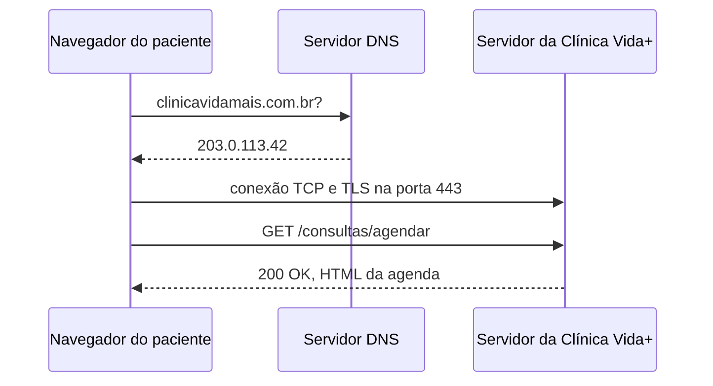

# Arquitetura da Clínica Vida+

## O caminho de uma requisição



## Evidência do DNS

```text
Servidor:  192.168.0.1
Address:  192.168.0.1

Não é resposta autoritativa:
Nome:    google.com
Addresses:  2800:3f0:4001:80d::200e
142.250.78.142
```

## Evidência do HTTP

| Método | Recurso                | Status |
| ------ | ---------------------- | ------ |
| GET    | jpg                    | 200    |
| GET    | script                 | 200    |
| GET    | svg/xml                | 200    |
| POST   | log                    | 200    |
| GET    | /pagina-que-nao-existe | 404    |

O formulário de agendamento da Clínica Vida+ precisa utilizar HTTPS para proteger os dados enviados pelo paciente durante a comunicação com o servidor. Dessa forma, as informações ficam criptografadas e mais protegidas contra interceptações. Um exemplo de dado sensível enviado pelo formulário é o CPF do paciente, além de informações relacionadas ao agendamento e aos seus dados pessoais.

